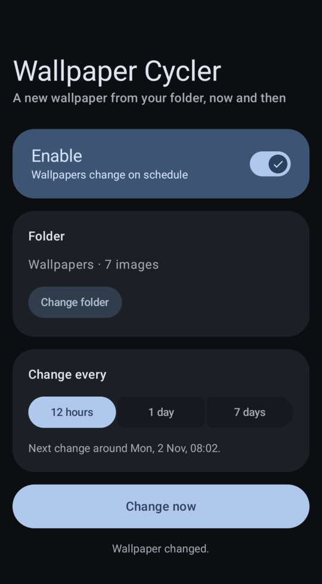

# Wallpaper Cycler

A small Android app that changes your wallpaper on a schedule. Pick a folder of images and how often to change (every 12 hours, every day or every week). The app sets a random image from the folder, never the one already on screen, on both the home and lock screens.

It sets an ordinary static wallpaper, so Android updates its Material You colours as usual. Nothing runs between changes: there's no live wallpaper or background service, just a scheduled job.

<p align="center"></p>

## Download
Get the APK from the [latest release](https://github.com/kshatriya-abhay/wallpaper-cycler/releases/latest). The release notes list its SHA-256 and the signing certificate's.

## Features
- One screen: an on/off switch, a folder, the frequency, and a "Change now" button.
- Works offline with local images. The app has no internet permission.
- Large photos are scaled down to the screen size before they're set.
- Built with Jetpack Compose and Material 3 Expressive.

## Requirements
Android 13 (API 33) or later.

## Building
You need JDK 21 and the Android SDK (set `sdk.dir` in `local.properties` or `ANDROID_HOME`).

```sh
./gradlew assembleDebug      # build
./gradlew testDebugUnitTest  # unit tests
./gradlew installDebug       # install on a connected device
```

With [mise](https://mise.jdx.dev), `mise run build`, `mise run test` and `mise run install` do the same.

## Notes
- Only images directly inside the chosen folder are used (not subfolders).
- Scheduled changes are approximate: Android runs background jobs when it suits the battery, so a "1 day" change may come a little early or late.
- Material 3 Expressive currently needs an alpha version of `androidx.compose.material3`.

## License
Apache License 2.0. See [LICENSE](LICENSE).

The launcher icon uses the "wallpaper" icon from Google's [Material icons](https://github.com/google/material-design-icons), also under Apache 2.0.
